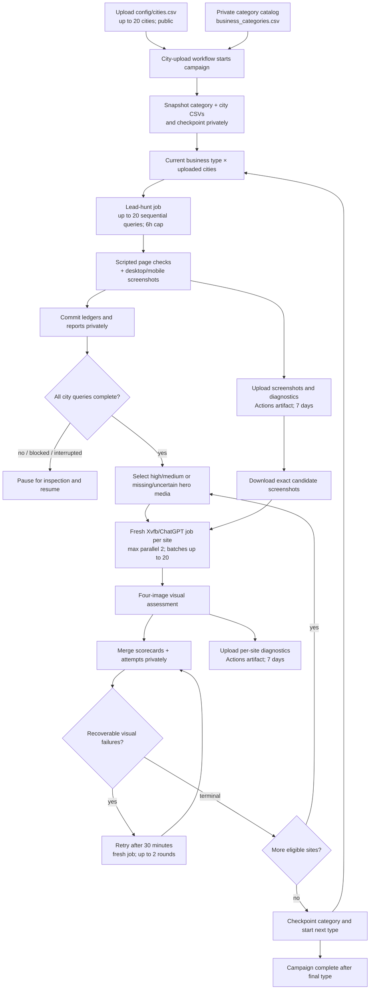

# ChatGPT Website Lead Hunting

This repository runs local-business discovery and direct website assessment in GitHub Actions. The lead-hunt workflow asks ChatGPT through a headed Playwright/Xvfb runner, visits returned direct business sites, and captures temporary desktop and mobile screenshots. A separate visual-review workflow sends four prepared screenshots per candidate to ChatGPT and saves a validated scorecard with the candidate record.

## Public code and private operations data

GitHub Actions runs in this public repository. The private `hometownredesignsites/website-lead-hunting-operations` repository has Actions disabled and stores the category/city CSVs, run ledgers, campaign checkpoints, retry queues, summaries, and durable visual scorecards. The public workflows use the `PRIVATE_RESULTS_TOKEN` Actions secret to check out and commit those records. The token is scoped to the private repository with Contents read/write access. A shared concurrency group serializes private-data writes across branches and workflows.

Actions logs and artifacts remain associated with the public repository. They may include business names, URLs, response text, screenshots, and diagnostics; storing durable ledgers in the private repo does not make those logs or artifacts private. Artifacts expire after seven days. GitHub Actions does not upload an artifact into a different repository. Run **Actions → Private results connection check** after configuring `PRIVATE_RESULTS_TOKEN`; it checks private read/write access and removes its temporary marker.

## Inputs and batch size

The orchestration uses two CSVs with different visibility and owners:

- `website-lead-hunting-operations/config/business_categories.csv` — private source of business types; requires an exact lowercase `category` column. The imported category catalog preserves its other source columns as metadata.
- Public `config/cities.csv` — upload the city list to this path on the `git-chatgpt` branch. It must have one `city` column and no more than 20 rows. Quote names containing commas. A starter file is [config/cities.example.csv](config/cities.example.csv).

Uploading or committing `config/cities.csv` starts the city-upload workflow. That city list is public and remains in public Git history. The workflow snapshots both inputs into the private operations repository before it dispatches work, so later city-list edits do not change an active campaign. A new commit to the city CSV starts a new campaign. The category catalog remains private and does not trigger Actions when it changes.

The campaign runs one business type at a time against all uploaded cities (up to 20). With 168 business types and 20 cities, the campaign contains up to 3,360 searches. For each business type it starts one lead-hunt job with at most 20 sequential queries and the existing six-hour timeout. The job runs the script-based technical checks and captures desktop/mobile images. It then automatically starts ChatGPT visual assessments for technical High/Medium candidates and for candidates whose first-viewport hero media is absent or uncertain, using screenshots from the lead-hunt run artifact. Visual jobs keep the current maximum parallelism of two and process up to 20 candidates per review dispatch.

After a visual batch, recoverable failures enter the existing retry queue and are retried about 30 minutes later in a fresh job, for up to two delayed rounds. The campaign waits while any candidate has a pending retry. Passed, permanently failed, or exhausted candidates are recorded in the private ledger; one candidate's visual failure does not stop the category or campaign. Once all eligible candidates have a terminal visual outcome, the coordinator checkpoints that category and dispatches the next business type. The workflow polls checkpoints and retry state every five minutes.

If a lead-hunt job is blocked, cancelled, or does not finish all cities successfully, the campaign pauses for inspection instead of silently skipping that category. Use **Actions → City-upload lead-hunt and visual-review campaign → Run workflow**, choose `resume`, and provide its campaign key after resolving the problem. The campaign key is `city-<12-character upload commit SHA>` and is printed in the workflow run name and summary. Checkpoints and category snapshots live in the private operations repository. Each lead-hunt workflow's screenshots and diagnostics remain in the public Actions artifact for seven days; scorecards and candidate records are durable private text data.

`Capture Google evidence` is an optional comparison pass that stores raw Google result snippets and reported counts beside ChatGPT's results. It is off by default. Google evidence extraction does not visit or independently assess every Google result.

## Workflow map

The city-upload coordinator chains discovery, script checks, visual scoring, and any delayed visual retries for each business type before starting the next one. Standalone lead hunts and visual reviews remain available for one-off work. The diagram shows the private checkpoints and durable scorecards, the public screenshot artifacts, and the automatic progression point.



The city controller, lead-hunt jobs, visual-review merges, and retry scheduler share one repository-wide Actions concurrency lock, protecting writes to the private `main` branch. A controller run commits its checkpoint and dispatches the next child while holding the lock; the six-hour Xvfb lead-hunt job runs as a separate workflow. Completion callbacks use `GITHUB_TOKEN` and `workflow_dispatch`, which GitHub permits to start another workflow. `PRIVATE_RESULTS_TOKEN` checks out and commits the private operations repository. Screenshots cannot be stored as private-repository Actions artifacts: artifacts belong to the public repository running the job.

**What starts each stage:** commit/upload the city CSV at `config/cities.csv` on `git-chatgpt`. To resume a paused campaign, manually dispatch the city-upload workflow with mode `resume` and that campaign key. Standalone work can still be started from **Actions → ChatGPT website lead hunt** or **Actions → ChatGPT visual review batch**. A visual review always downloads screenshots from its source lead-hunt run artifact; it never falls back to screenshots in the repository.

**Checkpoint and retention:** the campaign does not advance to the next business type until its script checks and eligible visual candidates have terminal outcomes, including any delayed retry rounds. Scorecards, candidate ledgers, reports, retry queues, campaign inputs, and checkpoints are durable text/data in the private operations repository. Screenshots and per-site diagnostics remain in public Actions artifacts for seven days. Workflows that write private state share `queue: max` and `cancel-in-progress: false`, preserving queued work and avoiding concurrent private-repository writes; scheduled polls may wait behind longer jobs.

## GitHub Actions runtime

The workflows use Node.js 24-compatible action releases: `actions/checkout@v5`, `actions/setup-python@v6`, and `actions/upload-artifact@v6`. The production ChatGPT runner uses headed Chromium under Xvfb through `tools/chatgpt_file_playwright_anonymous_ci.py` and the supporting `tools/playwright_runner/` modules. It waits for and validates responses, can request a short same-chat follow-up when a visual response is blank or lacks a scorecard, and records diagnostics. Within a candidate job, the runner uses its same-session retry and refresh behavior. If the outcome remains recoverable, the scheduled retry workflow starts a later job with a fresh browser profile, up to two delayed rounds. The workflows do not attempt CAPTCHA handling.

The prompt requests independent local businesses with direct official website URLs, supporting source URLs, and service-area evidence. The workflow filters known directories and aggregators, checks candidate URLs and redirects against public-address rules, visits eligible sites directly, and keeps automated visual suggestions separate from the human decision.

## Run outputs and audit

Each private `runs/<run_key>/` folder contains:

- `RUN_MANIFEST.json` — input fingerprint, source CSV hashes, engine, and review policy.
- `QUERY_LEDGER.jsonl` — prompt, response paths, sources, status, returned candidates, and dispositions.
- `CANDIDATE_LEDGER.jsonl` — deduplicated candidate sites, direct-site evidence, structured site-check findings, screenshot paths, and review fields.
- `LOCATION_CATEGORY_PROGRESS.json` and `BEHAVIOR_LOG.jsonl` — progress and chronological events.
- `GOOGLE_SEARCH_LEDGER.jsonl` and `search_evidence/google/` — optional raw Google comparison evidence.
- `RUN_SUMMARY.json` and `RUN_SUMMARY.md` — validator report with expected/processed queries, returned/reviewed candidates, dispositions, site visits, and review status.
- `HIGH_MEDIUM_CANDIDATES.csv` — import-ready shortlist of candidates with either an automated or ChatGPT visual high/medium opportunity signal. The export includes scores, current review/attempt statuses, and concise evidence notes.
- `CHATGPT_VISUAL_REVIEW_RETRY_QUEUE.json` — durable retry state for candidates awaiting an automatic delayed review.
- `chatgpt/` — text response records and diagnostics. Screenshots are attached to the seven-day Actions artifact in the public repository for inference; they are not committed to either repository.

`tools/validate_run.py` reconciles query indices and CSV inputs, candidate dispositions, review counts, and screenshot references. The workflow writes a summary even when the research step fails, so partial progress stays inspectable.

## Automated website checks

Each directly assessed candidate now gets a `site_checks` object in `CANDIDATE_LEDGER.jsonl`. It keeps observable checks separate from the visual score and human decision. `RUN_SUMMARY.json` and `RUN_SUMMARY.md` report aggregate outcomes.

- **HTTP links and insecure resources:** records declared HTTP anchors and resources, request/status, redirects, final URL, and whether the destination ends on HTTPS. It checks at most 12 prioritized HTTP or same-site links per homepage; entries beyond the cap are reported as partial coverage. Browser-observed HTTP resources include page assets such as stylesheets, scripts, images, fonts, and media.
- **Broken images:** scrolls up to 20 lazy-loaded images into view before measuring and capturing. Failed image entries include URL, alt text, `loading` state, and whether the bounded lazy-load pass completed. CSS background image failures are included when the browser reports a failed image request.
- **Contact form and privacy link:** detects native HTML forms and visible form-like field/submit groups on the home page, then, when needed, checks up to two linked same-site contact pages until a form is found. It reports whether a privacy-policy link was found on inspected pages; it does not judge legal adequacy.
- **Contact email domain:** looks for publicly displayed email addresses in homepage text and `mailto:` links, and checks up to two linked same-site contact pages when the homepage has no email or no detected form. A recognized consumer provider (such as Gmail, Yahoo, or Outlook) whose domain differs from the website domain is reported as a weak small-business opportunity clue. It does not establish business size or redesign need.
- **Broken links and interactions:** checks up to 12 prioritized HTTP or same-site links, same-page fragment targets, browser request failures, and JavaScript console errors. It smoke-tests up to eight accessible menu, disclosure, or tab controls. It never submits contact forms or clicks purchase, account, or other transactional controls. A 401/403/429 response is reported as restricted/rate-limited rather than automatically called a broken link.
- **Blog freshness:** looks for linked blog/news pages, then tries a few conventional same-site routes. It reports the latest published date and source URL when found, otherwise `not_found`.
- **Content freshness without a blog:** checks visible `<time>` elements, article dates, structured `datePublished`/`dateModified`, relevant portfolio/project pages, HTTP `Last-Modified`, and sitemap `lastmod`. Structured/visible content dates are stronger signals; server and sitemap dates are weak clues. Copyright years are excluded: a current year can be generated automatically and does not show when content was updated. An old displayed year is reported separately as a weak possible stale-footer clue and can never establish content freshness. If no meaningful content date is found, the result is `unknown`, not a claim that the site is stale. The report includes date age in days and an age band when a date is available.
- **Legacy Twitter branding:** flags likely Twitter bird/logo assets when no recognizable X logo asset is found. It does not treat a Twitter account link by itself as an old logo; asset detection is heuristic and should be visually confirmed.
- **First-viewport hero media:** at desktop and mobile widths, records visible image, video, and CSS background-image bounds, size, and position relative to the first visible H1 and likely primary CTA. A prominent-media threshold is used only to decide whether the page needs image assessment; it does not judge image quality. No prominent media or an uncertain headline boundary in either view routes the candidate to visual review.

The initial technical screen also records the homepage response status and final HTTPS scheme, title and metadata presence, contact path and CTA presence, image load ratio, mobile viewport metadata, and horizontal overflow at a 390 px viewport. It captures desktop and mobile page screenshots and uses these signals for an initial technical-opportunity score. A first-viewport hero-media check at desktop and mobile widths records visible image/video/background-image dimensions and positions relative to the first visible H1 and primary CTA. If no prominent media is detected, or the headline/hero boundary is uncertain in either view, the candidate is routed to visual assessment even when its technical priority is `pass`; the script does not judge whether imagery is attractive. A detected consumer-email/domain mismatch adds 5 points to the final opportunity score when the scripted evidence is sufficient, and the final priority band is computed after that bonus. An old copyright year (at least five years old) is one low-weight outdatedness signal; a current year adds no freshness evidence.

These checks are bounded for batch runtime, so the result includes scope limits and can report `partial` or `unknown`. They inspect the homepage plus a small set of relevant same-site pages, not every URL on a business's domain. Four-image ChatGPT visual assessment is a separate stage. It covers desktop top/mid and mobile top/mid views for visual judgments such as hero imagery, text contrast, layout, hierarchy, clutter, image presentation, and mobile usability. The assessment also receives a structured summary of the initial script audit; those findings remain separate from screenshot observations and the screenshot-only visual score. After assessment, the validator recalculates the durable score as `min(100, 30 + 10 × moderate_clusters + 20 × severe_clusters)` and derives the verdict; the model-reported score and verdict are retained separately for audit. Bands are `pass` 0–49, `medium` 50–74, and `high` 75–100; `uncertain` has no score. If either severity section is missing, each non-empty major issue is treated as one moderate cluster and no severe cluster is inferred. See [`docs/VISUAL_SCORING.md`](docs/VISUAL_SCORING.md) for severity rules and [`docs/HUMAN_REVIEW_BENCHMARK.md`](docs/HUMAN_REVIEW_BENCHMARK.md) for private cohort comparison. These visual bands are separate from the initial technical-priority score.

For a standalone group of sites, use **Actions → ChatGPT visual review batch**. Enter the source lead-hunt run ID and run key. Leave candidate IDs blank to automatically select the next eligible candidates with no valid visual score, or provide IDs for a targeted batch. Auto-selection reads `runs/<run_key>/CANDIDATE_LEDGER.jsonl` from the private operations repository and requires `site_check_status=loaded` plus either `automated_priority=high/medium` or absent/uncertain first-viewport hero media. It skips a valid scorecard and candidates whose latest attempt is already `retry-needed` or `failed`; those outcomes remain under their retry or human-follow-up path. Each dispatch selects at most 20 candidates and runs at most two isolated Xvfb/ChatGPT jobs at once, with `fail-fast` disabled. After the batch is merged and committed, another standalone batch can be started with the same run key and source run ID; selection resumes from the committed candidate ledger. If none are eligible, planning succeeds with a zero-candidate completion message and no review jobs run. City-upload campaigns chain later visual batches automatically.

Each site job uses the established runner behavior: one persistent browser profile for that candidate, with the runner's in-session retry and refresh behavior enabled. An empty or scoreless first response can receive a short text follow-up in the same chat before the attempt is classified. A permanent input or identity problem is `failed`; a recoverable problem that persists through the runner's retry is `retry-needed`; a validated scorecard is `passed`. Candidate failures do not stop other candidates or prevent the merge from saving their results. After all jobs finish, the workflow merges valid scorecards into their matching `chatgpt_visual_review` candidate-ledger fields, records attempt status and failure class, refreshes the run summary, and commits those text records to the private operations repository before that dispatch ends. The GitHub Actions step summary explicitly counts passed, retry-needed, and failed candidates and lists their IDs. A green workflow means statuses were recorded and committed; it does not mean every candidate passed. Detailed responses, screenshots, network logs, and runner diagnostics stay in the seven-day per-candidate artifacts. A workflow-level failure is reserved for execution problems that prevent the batch from being planned, merged, or committed. Recoverable candidates marked `retry-needed` are queued for up to two delayed automatic rounds; each delayed round starts a new job and browser profile. Run another blank-ID batch after those rounds if you want to resume with remaining unreviewed candidates.

The fixture-driven recovery checks cover missing source screenshots, screenshot upload mismatches, unavailable source artifacts, blank responses, invalid scorecards, identity mismatches, missing per-candidate artifacts from interrupted jobs, and automatic batch selection/checkpoint behavior. Run them with `python -m unittest tests.test_visual_review_recovery tests.test_visual_review_matrix -v`; they do not make live ChatGPT calls.

## Automatic visual-review retries

When a batch merge records a recoverable `retry-needed` result, it writes a due time 30 minutes later to `CHATGPT_VISUAL_REVIEW_RETRY_QUEUE.json`. **Actions → Schedule ChatGPT visual review retries** checks due entries every five minutes, verifies that the original lead-hunt artifact still exists, and dispatches only candidates whose latest attempt still needs a retry. It commits each retry reservation before dispatching the review workflow, so the review job can validate the reservation from the branch. This normally starts the retry about 30–35 minutes after failure; GitHub may delay scheduled events under load. The scheduler runs from the default branch and shares the lead-hunt concurrency lock so queue writes and ledger merges do not race.

The scheduler allows two delayed rounds after the initial batch. Each round starts a new candidate job with the established in-session retry behavior; it does not create three separate fresh profiles inside a job. A passing score resolves the queue entry, a permanent `failed` result is not retried, and candidates still marked `retry-needed` after both automatic rounds are left for manual follow-up. To review one of those candidates again, dispatch a targeted batch with its explicit candidate ID; blank-ID automatic selection skips it. If the source artifact has expired or is unavailable, the queue records that new screenshots are required instead of repeatedly dispatching reviews that cannot start. Source artifacts are retained for seven days.

## Temporary image scoring and cleanup

Images are temporary inference inputs. The workflow uploads them with the complete run folder as a GitHub Actions artifact for seven days. They are excluded from Git commits by policy and `.gitignore`; the visual-review workflow reads screenshots only from the source Actions artifact and does not fall back to repository files. The generated high/medium CSV and candidate ledger remain durable in the private operations repository after the public artifact expires.

The main lead-hunt workflow does not automatically run visual inference. For the existing Hermes path, download and extract an artifact into `runs/<run_key>/`, configure the local Hermes CLI/provider, and run:

```bash
python tools/complete_visual_reviews.py --run-dir runs/<run-key>
python tools/validate_run.py --run-dir runs/<run-key> --write-summary
python tools/purge_screenshots.py --run-key <run-key>
python tools/purge_screenshots.py --run-key <run-key> --apply
```

The first purge command is a dry run. `--apply` deletes local image files after every candidate with a saved website screenshot has an assessed Hermes review. It preserves ledgers and text evidence and records the purge in the manifest. This optional local cleanup is for extracted or downloaded run folders; GitHub Actions artifacts in the public repository expire after seven days. Hermes visual scoring uses desktop candidate screenshots; it is advisory and does not complete the human decision.

The current public branch no longer stores run records or configuration; they are loaded from the private operations repository at runtime. Removing files from the public branch does not erase earlier copies from public Git history or past Actions artifacts.

## ChatGPT runner check

**Actions → ChatGPT Xvfb runner check** sends one-off prompts through the same Xvfb runner. It uploads the answer, metadata, success screenshot, and diagnostics as a seven-day artifact; it does not commit probe files to a run folder. **Attach test image** checks basic image upload and recognition with a synthetic fixture. **Review saved candidate** is a single-candidate capability probe: it requires the numeric source run ID from the lead-hunt Actions URL and downloads that run's `lead-hunt-<run_key>-<run_id>` artifact, which includes the candidate ledger and temporary screenshots. It reads the candidate and screenshots only from that downloaded artifact. If the artifact, ledger, or any source screenshot is unavailable, the workflow fails; it does not fall back to checked-in repository files. It prepares four JPEG viewport crops: desktop top, desktop mid-page, mobile top, and mobile mid-page. Mid-page crops are centered at 35% of the desktop and 60% of the mobile screenshot's scrollable height. All four are attached to guest ChatGPT. Both the one-off probe and batch review use the runner's in-session refresh/retry behavior; the batch scheduler can later dispatch a new job with a fresh profile for recoverable failures.

The current review and checkpoint path was verified by [GitHub Actions visual review run #7](https://github.com/hometownredesignsites/website-lead-hunting/actions/runs/41565515143): one candidate received a validated scorecard, the merge job committed it, and the job summary reported candidate outcome counts. Screenshots remain only in the short-lived Actions artifact.

## Recent live validation

- **Paired Christie's visual scoring:** [ChatGPT run 41771379776](https://github.com/hometownredesignsites/website-lead-hunting/actions/runs/41771379776) on `git-chatgpt` and [Duck.ai run 41771342547](https://github.com/hometownredesignsites/website-lead-hunting/actions/runs/41771342547) on `git-duckai` reviewed the same candidate and source screenshots. The durable scores were 30/Pass and 40/Pass. Duck.ai's raw 55/Medium response was retained separately; its one major issue produced a 40/Pass durable score under the missing-severity fallback. This is one paired validation, not a guarantee of identical model judgments.
- **Automatic visual candidate selection:** [run 41575293012](https://github.com/hometownredesignsites/website-lead-hunting/actions/runs/41575293012) left the candidate-ID input blank. The selector chose one eligible candidate from the committed ledger, the isolated candidate job returned a validated scorecard (57, medium, high confidence), and the merge committed the score to the test branch. This proves the auto-select-to-score path for one candidate; it is not a production campaign or a reliability-rate estimate.
- **Campaign callback and checkpoint:** [campaign run 41577057133](https://github.com/hometownredesignsites/website-lead-hunting/actions/runs/41577057133) dispatched a one-query child lead hunt. The child completed, its notification job dispatched the coordinator, and [callback run 41577457339](https://github.com/hometownredesignsites/website-lead-hunting/actions/runs/41577457339) recorded the campaign as complete with 1/1 successful queries and one completed batch. This validates automatic advancement for a one-query smoke test, not a full multi-batch campaign.
- **Local fixture suite:** 39 tests passed during implementation, including campaign checkpoint and dispatch behavior. These tests do not replace a live large-campaign run.

The automatic-selection and campaign-callback proofs above used isolated test branches. The paired Christie's scorecards were committed to the private operations branches used by the two providers for this comparison; they cover one candidate and are not a reliability-rate estimate. No 3,200-query campaign has been run.

## Local checks

```bash
python -m unittest discover -s tests -v
python -m py_compile tools/lead_hunt.py tools/chatgpt_file_playwright_anonymous_ci.py tools/playwright_runner/browser_session.py
```

The batch workflow commits scorecards, attempt status, text summaries, and the refreshed high/medium CSV to the private operations repository. Source screenshots and review diagnostics remain in seven-day Actions artifacts attached to the public workflow repository; Actions artifacts cannot be stored in a different repository than the one running the workflow.
