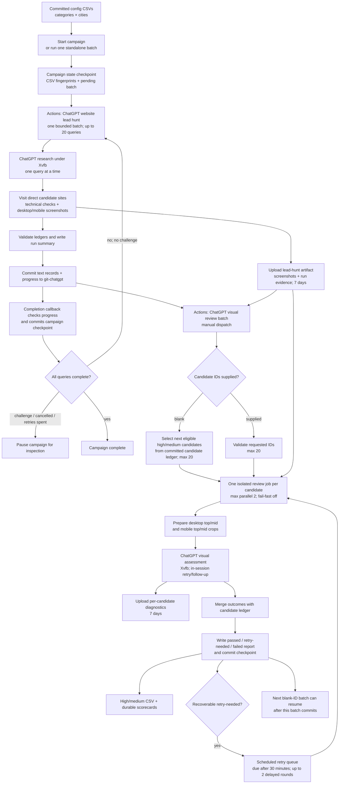

# ChatGPT Website Lead Hunting

This repository runs local-business discovery and direct website assessment in GitHub Actions. The lead-hunt workflow asks ChatGPT through a headed Playwright/Xvfb runner, visits returned direct business sites, and captures temporary desktop and mobile screenshots. A separate visual-review workflow sends four prepared screenshots per candidate to ChatGPT and saves a validated scorecard with the candidate record.

## Inputs and batch size

The workflow reads two committed CSVs under `config/`:

- `config/business_categories.csv` — one `category` column.
- `config/cities.csv` — one `city` column; values containing commas should be quoted.

The included rows are starter examples. Replace them with the complete approved category and city lists before a market run. The planning step prints the Cartesian product and the current batch size before research begins.

For one bounded lead-hunt run, open **Actions → ChatGPT website lead hunt → Run workflow** on the `git-chatgpt` branch. Use a stable `run_key` to resume the same inputs. A changed category/city set requires a new key. Each dispatch processes up to 20 pending category/city prompts and assesses up to 10 sites per prompt. Lead-hunt prompts run sequentially; this stage has no schedule or parallel query fan-out. It uses a six-hour job timeout.

For an automatically checkpointed campaign, use **Actions → Lead-hunt campaign coordinator → Run workflow** and choose `start`. Give the campaign a new `run_key`, then choose a batch size, sites-per-query limit, and retry allowance. The coordinator fingerprints the committed CSVs, creates `runs/<run_key>/CAMPAIGN_STATE.json`, and dispatches one regular lead-hunt workflow run. Each child run commits its query/candidate ledger and progress. On completion, the coordinator reads the run metadata and committed progress, checkpoints the campaign, then dispatches the next bounded batch. At 20 queries per batch, 3,200 queries take at least 160 child runs; the coordinator removes the need for 160 manual dispatches while keeping the browser jobs below the six-hour timeout. Start at 2–5 queries per batch, measure run duration and successful-query rate, then raise the batch size gradually.

The campaign stops as `complete` when all CSV combinations have a successful terminal record. It retries a failed batch at most the configured number of times, but pauses without retrying when Google/ChatGPT reports a challenge or when the child run is cancelled. It also pauses after its retry allowance is exhausted. To continue a paused campaign, run **Lead-hunt campaign coordinator** again with mode `resume` and the same `run_key`, after inspecting the diagnostics and resolving any challenge. Campaigns require the original committed CSV content; a fingerprint mismatch is rejected. `CAMPAIGN_STATE.json` records the batch/attempt numbers, progress, run IDs, and pause reason, so completed batches remain checkpointed in Git if a later batch is interrupted.

`Capture Google evidence` is an optional comparison pass that stores raw Google result snippets and reported counts beside ChatGPT's results. It is off by default. Google evidence extraction does not visit or independently assess every Google result.

## Workflow map

The campaign coordinator chains bounded lead-hunt runs; standalone lead hunts and visual reviews can still be started manually. Only the visual-review retry scheduler runs on a schedule. The diagram shows what persists in Git, what stays in short-lived Actions artifacts, and where a later campaign batch resumes.



The campaign controller and the child lead-hunt job use the same per-branch Actions concurrency lock. A controller run holds it only long enough to commit state and dispatch the next child; the six-hour Xvfb run remains a separate workflow. After the lead-hunt job finishes, a small callback job dispatches the coordinator with `GITHUB_TOKEN`; the coordinator reads the completed run's REST record and committed progress before advancing the checkpoint. This explicit callback is needed because GitHub suppresses most follow-on events from `GITHUB_TOKEN`, while `workflow_dispatch` is an allowed exception. The callback includes the final lead-hunt job result, so a failed or cancelled child is recorded even though the callback runs before the enclosing workflow's final status is set. No personal token secret is required.

**What starts each stage:** use the campaign coordinator for hands-off sequential lead-hunt batches, or start **Actions → ChatGPT website lead hunt** directly for a one-off bounded run. The visual batch is started from **Actions → ChatGPT visual review batch** after the lead-hunt run has committed its ledger. Enter its run key and Actions run ID; leave candidate IDs blank for automatic selection, or provide IDs for a targeted batch. The review workflow downloads screenshots from that lead-hunt run's artifact; it never falls back to screenshots in the repository. The retry scheduler checks due retry records every five minutes and dispatches those reviews automatically.

**Checkpoint and retention:** each visual batch merges and pushes its text results before it completes. The next batch uses that committed ledger, so completed visual scores are skipped. A blank-ID selection with zero eligible candidates succeeds with “No eligible candidates; batch complete” and skips review and merge jobs. Screenshots and per-candidate diagnostics remain in Actions artifacts for seven days; candidate ledgers, summaries, retry queues, and CSV exports are committed text records. The lead-hunt concurrency lock serializes lead hunts, visual-review merges, and retry-queue writes on the same branch. These three workflows use GitHub Actions `queue: max`, which allows up to 100 pending runs in the shared group instead of replacing the existing pending run; active work is not canceled. Scheduled retry polls share this queue and may wait behind other work.

## GitHub Actions runtime

The workflows use Node.js 24-compatible action releases: `actions/checkout@v5`, `actions/setup-python@v6`, and `actions/upload-artifact@v6`. The production ChatGPT runner uses headed Chromium under Xvfb through `tools/chatgpt_file_playwright_anonymous_ci.py` and the supporting `tools/playwright_runner/` modules. It waits for and validates responses, can request a short same-chat follow-up when a visual response is blank or lacks a scorecard, and records diagnostics. Within a candidate job, the runner uses its same-session retry and refresh behavior. If the outcome remains recoverable, the scheduled retry workflow starts a later job with a fresh browser profile, up to two delayed rounds. The workflows do not attempt CAPTCHA handling.

The prompt requests independent local businesses with direct official website URLs, supporting source URLs, and service-area evidence. The workflow filters known directories and aggregators, checks candidate URLs and redirects against public-address rules, visits eligible sites directly, and keeps automated visual suggestions separate from the human decision.

## Run outputs and audit

Each `runs/<run_key>/` folder contains:

- `RUN_MANIFEST.json` — input fingerprint, source CSV hashes, engine, and review policy.
- `QUERY_LEDGER.jsonl` — prompt, response paths, sources, status, returned candidates, and dispositions.
- `CANDIDATE_LEDGER.jsonl` — deduplicated candidate sites, direct-site evidence, structured site-check findings, screenshot paths, and review fields.
- `LOCATION_CATEGORY_PROGRESS.json` and `BEHAVIOR_LOG.jsonl` — progress and chronological events.
- `GOOGLE_SEARCH_LEDGER.jsonl` and `search_evidence/google/` — optional raw Google comparison evidence.
- `RUN_SUMMARY.json` and `RUN_SUMMARY.md` — validator report with expected/processed queries, returned/reviewed candidates, dispositions, site visits, and review status.
- `HIGH_MEDIUM_CANDIDATES.csv` — import-ready shortlist of candidates with either an automated or ChatGPT visual high/medium opportunity signal. The export includes scores, current review/attempt statuses, and concise evidence notes.
- `CHATGPT_VISUAL_REVIEW_RETRY_QUEUE.json` — durable retry state for candidates awaiting an automatic delayed review.
- `chatgpt/` — text response records and diagnostics. Screenshots are attached to the seven-day Actions artifact for inference and are not committed to the repository.

`tools/validate_run.py` reconciles query indices and CSV inputs, candidate dispositions, review counts, and screenshot references. The workflow writes a summary even when the research step fails, so partial progress stays inspectable.

## Automated website checks

Each directly assessed candidate now gets a `site_checks` object in `CANDIDATE_LEDGER.jsonl`. It keeps observable checks separate from the visual score and human decision. `RUN_SUMMARY.json` and `RUN_SUMMARY.md` report aggregate outcomes.

- **HTTP links and insecure resources:** records declared HTTP anchors and resources, request/status, redirects, final URL, and whether the destination ends on HTTPS. It checks at most 12 prioritized HTTP or same-site links per homepage; entries beyond the cap are reported as partial coverage. Browser-observed HTTP resources include page assets such as stylesheets, scripts, images, fonts, and media.
- **Broken images:** scrolls up to 20 lazy-loaded images into view before measuring and capturing. Failed image entries include URL, alt text, `loading` state, and whether the bounded lazy-load pass completed. CSS background image failures are included when the browser reports a failed image request.
- **Contact form and privacy link:** detects native HTML forms and visible form-like field/submit groups on the home page, then, when needed, checks up to two linked same-site contact pages until a form is found. It reports whether a privacy-policy link was found on inspected pages; it does not judge legal adequacy.
- **Contact email domain:** looks for publicly displayed email addresses in homepage text and `mailto:` links, and checks up to two linked same-site contact pages when the homepage has no email or no detected form. A recognized consumer provider (such as Gmail, Yahoo, or Outlook) whose domain differs from the website domain is reported as a weak small-business opportunity clue. It does not establish business size or redesign need.
- **Broken links and interactions:** checks up to 12 prioritized HTTP or same-site links, same-page fragment targets, browser request failures, and JavaScript console errors. It smoke-tests up to eight accessible menu, disclosure, or tab controls. It never submits contact forms or clicks purchase, account, or other transactional controls. A 401/403/429 response is reported as restricted/rate-limited rather than automatically called a broken link.
- **Blog freshness:** looks for linked blog/news pages, then tries a few conventional same-site routes. It reports the latest published date and source URL when found, otherwise `not_found`.
- **Content freshness without a blog:** checks visible `<time>` elements, article dates, structured `datePublished`/`dateModified`, relevant portfolio/project pages, HTTP `Last-Modified`, and sitemap `lastmod`. Structured/visible content dates are stronger signals; server and sitemap dates are weak clues. Copyright years are excluded: a current year can be generated automatically and does not show when content was updated. An old displayed year is reported separately as a weak possible stale-footer clue and can never establish content freshness. If no meaningful content date is found, the result is `unknown`, not a claim that the site is stale. The report includes date age in days and an age band when a date is available.
- **Legacy Twitter branding:** flags likely Twitter bird/logo assets when no recognizable X logo asset is found. It does not treat a Twitter account link by itself as an old logo; asset detection is heuristic and should be visually confirmed.

The initial technical screen also records the homepage response status and final HTTPS scheme, title and metadata presence, contact path and CTA presence, image load ratio, mobile viewport metadata, and horizontal overflow at a 390 px viewport. It captures desktop and mobile page screenshots and uses these signals for an initial technical-opportunity score. A detected consumer-email/domain mismatch adds 5 opportunity points only if the technical score was already medium or high; it cannot turn a technically passing candidate into a medium. An old copyright year (at least five years old) is one low-weight outdatedness signal; a current year adds no freshness evidence.

These checks are bounded for batch runtime, so the result includes scope limits and can report `partial` or `unknown`. They inspect the homepage plus a small set of relevant same-site pages, not every URL on a business's domain. Four-image ChatGPT visual assessment is a separate stage. It covers desktop top/mid and mobile top/mid views for visual judgments such as hero imagery, text contrast, layout, hierarchy, clutter, image presentation, and mobile usability. The visual score follows the rubric used by the successful browser run: high for a severe flaw or several major flaws, and medium for a meaningful opportunity such as dated styling, weak hierarchy, sparse or poor project photos, text-heavy layout, or confusing navigation. The screenshots must visibly support the score; this review does not make functional claims that require scripted checks.

For a group of sites, use **Actions → ChatGPT visual review batch**. Enter the source lead-hunt run ID and run key. Leave candidate IDs blank to automatically select the next eligible high/medium candidates with no valid visual score, or provide IDs for a targeted batch. Auto-selection reads `runs/<run_key>/CANDIDATE_LEDGER.jsonl` on the selected branch and requires `site_check_status=loaded` and `automated_priority=high` or `medium`. It skips a valid scorecard and candidates whose latest attempt is already `retry-needed` or `failed`; those outcomes remain under their retry or human-follow-up path. Each dispatch selects at most 20 candidates and runs at most two isolated Xvfb/ChatGPT jobs at once, with `fail-fast` disabled. After the batch is merged and committed, start another dispatch with the same run key and source run ID and leave candidate IDs blank; selection resumes from the committed candidate ledger, so completed scores are not lost or repeated. The plan report shows how many candidates were eligible and how many remain. If none are eligible, planning succeeds with a zero-candidate completion message and no review jobs run. The later batch is not automatically self-chained.

Each site job uses the established runner behavior: one persistent browser profile for that candidate, with the runner's in-session retry and refresh behavior enabled. An empty or scoreless first response can receive a short text follow-up in the same chat before the attempt is classified. A permanent input or identity problem is `failed`; a recoverable problem that persists through the runner's retry is `retry-needed`; a validated scorecard is `passed`. Candidate failures do not stop other candidates or prevent the merge from saving their results. After all jobs finish, the workflow merges valid scorecards into their matching `chatgpt_visual_review` candidate-ledger fields, records attempt status and failure class, refreshes the run summary, and commits those text records to the selected branch before that dispatch ends. The GitHub Actions step summary explicitly counts passed, retry-needed, and failed candidates and lists their IDs. A green workflow means statuses were recorded and committed; it does not mean every candidate passed. Detailed responses, screenshots, network logs, and runner diagnostics stay in the seven-day per-candidate artifacts. A workflow-level failure is reserved for execution problems that prevent the batch from being planned, merged, or committed. Recoverable candidates marked `retry-needed` are queued for up to two delayed automatic rounds; each delayed round starts a new job and browser profile. Run another blank-ID batch after those rounds if you want to resume with remaining unreviewed candidates.

The fixture-driven recovery checks cover missing source screenshots, screenshot upload mismatches, unavailable source artifacts, blank responses, invalid scorecards, identity mismatches, missing per-candidate artifacts from interrupted jobs, and automatic batch selection/checkpoint behavior. Run them with `python -m unittest tests.test_visual_review_recovery tests.test_visual_review_matrix -v`; they do not make live ChatGPT calls.

## Automatic visual-review retries

When a batch merge records a recoverable `retry-needed` result, it writes a due time 30 minutes later to `CHATGPT_VISUAL_REVIEW_RETRY_QUEUE.json`. **Actions → Schedule ChatGPT visual review retries** checks due entries every five minutes, verifies that the original lead-hunt artifact still exists, and dispatches only candidates whose latest attempt still needs a retry. It commits each retry reservation before dispatching the review workflow, so the review job can validate the reservation from the branch. This normally starts the retry about 30–35 minutes after failure; GitHub may delay scheduled events under load. The scheduler runs from the default branch and shares the lead-hunt concurrency lock so queue writes and ledger merges do not race.

The scheduler allows two delayed rounds after the initial batch. Each round starts a new candidate job with the established in-session retry behavior; it does not create three separate fresh profiles inside a job. A passing score resolves the queue entry, a permanent `failed` result is not retried, and candidates still marked `retry-needed` after both automatic rounds are left for manual follow-up. To review one of those candidates again, dispatch a targeted batch with its explicit candidate ID; blank-ID automatic selection skips it. If the source artifact has expired or is unavailable, the queue records that new screenshots are required instead of repeatedly dispatching reviews that cannot start. Source artifacts are retained for seven days.

## Temporary image scoring and cleanup

Images are temporary inference inputs. The workflow uploads them with the complete run folder as a GitHub Actions artifact for seven days. They are excluded from Git commits by policy and `.gitignore`; the visual-review workflow reads screenshots only from the source Actions artifact and does not fall back to repository files. The generated high/medium CSV and candidate ledger remain durable in the branch after the artifact expires.

The main lead-hunt workflow does not automatically run visual inference. For the existing Hermes path, download and extract an artifact into `runs/<run_key>/`, configure the local Hermes CLI/provider, and run:

```bash
python tools/complete_visual_reviews.py --run-dir runs/<run-key>
python tools/validate_run.py --run-dir runs/<run-key> --write-summary
python tools/purge_screenshots.py --run-key <run-key>
python tools/purge_screenshots.py --run-key <run-key> --apply
```

The first purge command is a dry run. `--apply` deletes local image files after every candidate with a saved website screenshot has an assessed Hermes review. It preserves ledgers and text evidence and records the purge in the manifest. This optional local cleanup is for extracted or downloaded run folders; GitHub Actions artifacts expire after seven days. Hermes visual scoring uses desktop candidate screenshots; it is advisory and does not complete the human decision.

Older screenshots were removed from both branch tips and Git history as part of the cleanup. This history rewrite changes commit IDs; collaborators with existing clones should fetch the rewritten branches and re-clone or reset local branches before pushing.

## ChatGPT runner check

**Actions → ChatGPT Xvfb runner check** sends one-off prompts through the same Xvfb runner. It uploads the answer, metadata, success screenshot, and diagnostics as a seven-day artifact; it does not commit probe files to a run folder. **Attach test image** checks basic image upload and recognition with a synthetic fixture. **Review saved candidate** is a single-candidate capability probe: it requires the numeric source run ID from the lead-hunt Actions URL and downloads that run's `lead-hunt-<run_key>-<run_id>` artifact, which includes the candidate ledger and temporary screenshots. It reads the candidate and screenshots only from that downloaded artifact. If the artifact, ledger, or any source screenshot is unavailable, the workflow fails; it does not fall back to checked-in repository files. It prepares four JPEG viewport crops: desktop top, desktop mid-page, mobile top, and mobile mid-page. Mid-page crops are centered at 35% of the desktop and 60% of the mobile screenshot's scrollable height. All four are attached to guest ChatGPT. Both the one-off probe and batch review use the runner's in-session refresh/retry behavior; the batch scheduler can later dispatch a new job with a fresh profile for recoverable failures.

The current review and checkpoint path was verified by [GitHub Actions visual review run #7](https://github.com/hometownredesignsites/website-lead-hunting/actions/runs/41565515143): one candidate received a validated scorecard, the merge job committed it, and the job summary reported candidate outcome counts. Screenshots remain only in the short-lived Actions artifact.

## Local checks

```bash
python -m unittest discover -s tests -v
python -m py_compile tools/lead_hunt.py tools/chatgpt_file_playwright_anonymous_ci.py tools/playwright_runner/browser_session.py
```

The batch workflow commits scorecards, attempt status, text summaries, and the refreshed high/medium CSV. Source screenshots and review diagnostics remain in seven-day Actions artifacts and are not added to Git history.
